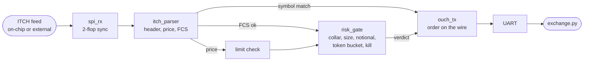

# FPGA Speculative Order Gateway

[](LICENSE)

A cut-through trading engine on a £15 Sipeed Tang Nano 9K (Gowin GW1NR-9C). It reads a NASDAQ ITCH 5.0 feed and starts sending an OUCH 4.2 buy order as soon as the stock symbol matches, before the price or the frame check have arrived. If the price is over the limit, the feed frame turns out corrupt, or the pre-trade risk gate says no, the order's FCS goes out inverted so the far end drops it. Built only with open source tools (yosys, nextpnr, apicula, cocotb and SymbiYosys). Made by Krystian Filipek.

## In Plain Terms

A trading system reads a stream of messages from an exchange ("someone wants to sell 100 Apple shares at $149.90") and decides whether to send an order back. The usual way is to wait for the whole message, check it, then start writing the reply. This design starts writing the reply the moment it knows the message is about Apple, while the price is still arriving. Most of an order (who you are, which stock, how many) does not depend on the price, so by the time the reply needs the price it is already in. If anything turns out wrong, it cannot pull back bytes already on the wire. Instead it ends the order with a deliberately wrong checksum, which every network device treats as line noise and throws away.

## Features

### Results
| Measurement | Result |
|-------------|--------|
| Symbol match to first order byte | 2 clocks (74 ns at 27 MHz), inside the core |
| SCK edge to the order's start bit | 6 clocks (222 ns), pin to pin, synchronisers included |
| Last feed byte to verdict | 3 clocks, the risk gate is one of them |
| Fabric | 1922 LUT4 (22%), 746 DFF, 2 DSP, 50 MHz post-route (27 MHz needed) |
| Verification | 4 SymbiYosys proofs (k-induction), 25 cocotb tests against a Python model, CI |

All numbers are from simulation and place and route, not yet from the board.

### What Is Proven
- **ouch_tx** - Every order is exactly 53 bytes and never cut short. The FCS is the true CRC only if a commit arrived before the first FCS byte left and the price arrived before its field. Every other case is stomped.
- **itch_parser** - A pass means all 40 bytes arrived, the type, side and symbol matched, and the received FCS equals the CRC of the 36 bytes before it. One verdict per trigger.
- **risk_gate** - No order while killed or outside the price collar, size and notional limits. Never more than BURST + 1 orders in any REFILL window.
- **hft_core** - All of the above together, plus: a good FCS only follows a risk grant for the order on the wire, and the gate only sees clean frames priced at or under the limit.

### Designs
- **rtl/itch_parser** - Add Order fields as they arrive, a trigger on the last symbol byte, then the price, then the FCS verdict
- **rtl/ouch_tx** - Enter Order built byte by byte from the latched fields, stomped FCS on any doubt
- **rtl/risk_gate** - Kill switch, price collar, size, notional and a token bucket rate limit, in one clock
- **rtl/feed_gen** - On-chip feed: a random stream and a scripted burst that walks every path
- **host/model.py** - Reference model shared by the tests and the exchange script
- **host/exchange.py** - The far end of the order port: hunts frames by FCS and checks each against the model

### Signal Flow


### Speculation Timeline
```
feed   ... | stock 24..31 | price 32..35 | fcs 36..39 |
                          ^ trigger, order starts
order                     | O | token 1..14 | B | qty | stock | price 28..31 | ... | fcs 49..52 |
                                                              ^ price needed   verdict needed ^
```
The order needs the price 28 bytes in and the verdict 49 bytes in. The feed delivers them 4 and 8 bytes after the trigger. So the order port can run about six times faster than the feed before a verdict comes too late. If it does, the frame is stomped, never sent unchecked.

## Getting Started

### Prerequisites
- **Linux x64** with `git`, `curl` and `make`
- **Sipeed Tang Nano 9K** board
- Optional: **8 channel logic analyser** (24 MHz fx2 class is enough) with PulseView

### Building the Project
1. Clone the repository:
   ```bash
   git clone https://github.com/kfilipekk/fpga_hft.git
   cd fpga_hft
   ```

2. Install the toolchain into `tools/` (nothing is installed globally):
   ```bash
   ./setup.sh
   source tools/oss-cad-suite/environment
   ```

3. Build, test and flash:
   ```bash
   make            # bitstream
   make sim        # cocotb
   make lint       # verilator
   make formal     # symbiyosys
   make flash      # load over usb
   ```

4. Watch the orders:
   ```bash
   python3 host/exchange.py /dev/ttyUSB1
   ```
   S1 plays the scripted burst, S2 toggles the kill switch.

### Logic Analyser
The engine's state sits on eight neighbouring header pins. Check them against the board's silkscreen before clipping on.

| Ch | Pin | Signal | Decode |
|----|-----|--------|--------|
| 0 | 25 | feed_sck | SPI clock |
| 1 | 26 | feed_mosi | SPI MOSI, the ITCH bytes |
| 2 | 27 | feed_cs_n | SPI CS#, one frame per message |
| 3 | 28 | ord_tx | UART 115200, the OUCH bytes |
| 4 | 29 | spec | order on the wire, verdict pending |
| 5 | 30 | risk_ok | gate has a token and no kill |
| 6 | 33 | tx_commit | verdict in, FCS will be good |
| 7 | 34 | tx_abort | rejected, FCS will be stomped |

In PulseView, sample at 24 MHz for 2 M samples and trigger on CH2 falling. Add an SPI decoder on D0-D2 and a UART decoder on D3, then press S1. The scripted burst is a good order, an over-limit price, a corrupt frame, a bad tick outside the collar, another stock, then good orders until the bucket runs dry.

## Applications

I made this project to explore:
- Cut-through processing and why speculation needs a way to take a frame back
- Pre-trade risk checks of the kind SEC Rule 15c3-5 asks for, in hardware
- Proving properties of a datapath with k-induction, not just testing it
- Checking hardware against a shared reference model at every level

## Future Plans

- Bench captures of the burst and the stomped frames
- Feed from an STM32 over the same SPI pins, so the trigger edge is truly asynchronous
- Time the trigger edge with the carry-chain TDC from [fpga_gps_clock](https://github.com/kfilipekk/fpga_gps_clock) for a picosecond wire-to-wire latency histogram
- MoldUDP64 framing in, SoupBinTCP framing out, and more than one order in flight

<div align="center">

Developed by [kfilipekk](https://github.com/kfilipekk)

</div>
