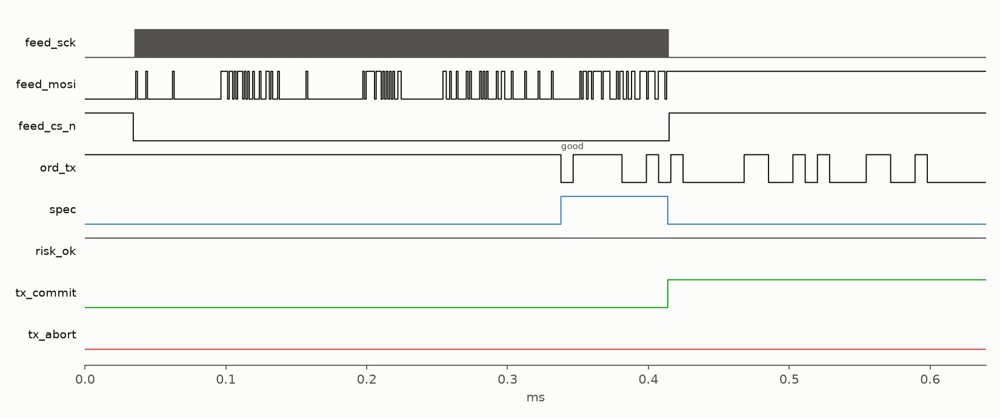
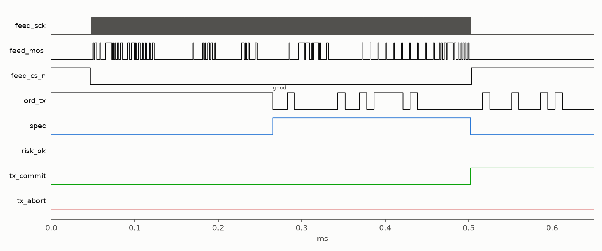
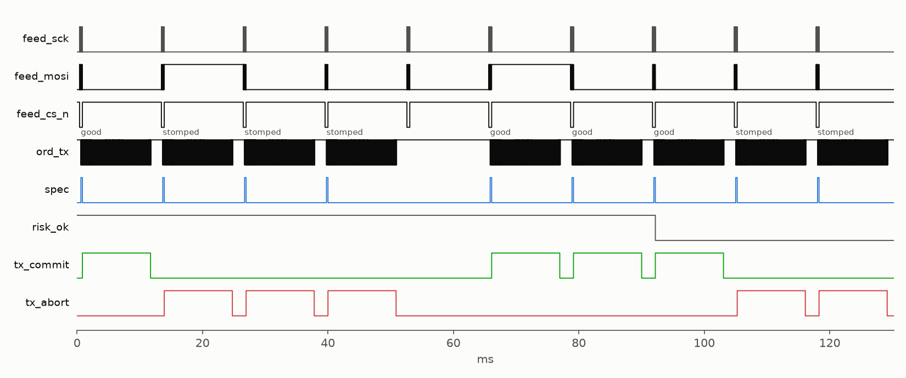
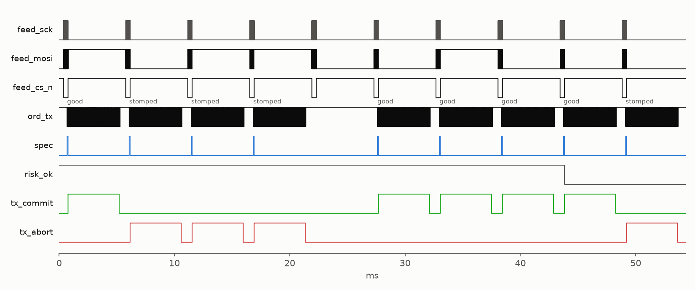

# FPGA Speculative Order Gateway

A cut-through trading engine on a Tang Nano 9K (GW1NR-9C). It reads add orders from the feed and starts sending a buy order as soon as the symbol matches, before the price or the frame check have arrived. If the price is over the limit, the feed frame is corrupt or the risk gate says no, the order's FCS goes out inverted and the far end drops it. Open source flow: yosys, nextpnr, apicula, cocotb, SymbiYosys.

Two venues, chosen at build time:
- **NASDAQ** - ITCH 5.0 Add Order in, OUCH 4.2 Enter Order out
- **LSE** - MITCH Add Order in ([MIT303](https://docs.londonstockexchange.com/sites/default/files/documents/mit303issue119.pdf)), Native Trading Gateway New Order out ([MIT203](https://docs.londonstockexchange.com/sites/default/files/documents/mit203_-_native_trading_gateway_specification_-_issue_19.0.0.pdf)), little endian, 8 decimal prices

## Results

On the board:

| Run | Result |
|-----|--------|
| NASDAQ ITCH 5.0, 30 Jan 2019 from 04:00 | 46,406 messages in 32 s at 1 Mbaud, every order matches the model |
| The 1,459 AAPL sells among them | 78 committed, 723 stomped on price, 658 by the rate limiter |
| Synthetic feed with cut and corrupted frames | 5,000 messages, 0 mismatches |
| LSE build, synthetic MITCH feed | 5,000 messages, 0 mismatches |
| SCK edge to order start bit, 24 MHz analyser | 208-250 ns (6 clocks, ±1 sample), both venues |
| S1 burst on the analyser, both venues | every path in order, 0 mismatches |

From simulation and place and route:

| | |
|-|-|
| Symbol match to first order byte | 2 clocks |
| Last feed byte to verdict | 3 clocks |
| Fabric | 2679 LUT4 (31%), 55 MHz (27 MHz needed), either venue |
| Tests | 7 formal proofs, 51 cocotb runs over both venues, 17 host tests |

No LSE market data is free, so the LSE build is tested against the published specs and a synthetic feed.

## How It Works

| | Trigger | Price in | Verdict in | Price needed | Verdict needed |
|-|-|-|-|-|-|
| NASDAQ | feed byte 31 | +4 bytes | +8 bytes | order byte 28 | order byte 49 |
| LSE | feed byte 22 | +10 bytes | +25 bytes | order byte 67 | order byte 125 |

The order needs the price and verdict much later than the feed delivers them, so it can start on the symbol. A late verdict or a missing price stomps the frame.



The same on the LSE build. The instrument id comes before the price in MITCH, so the order starts with more of the feed frame still to come.



Proven with k-induction:
- **order_tx** - a full frame every time, and a good FCS only after a commit that beat it, for both venues
- **itch_parser, mitch_parser** - a pass means a full frame, matching header and a correct FCS
- **risk_gate** - nothing while killed or out of limits, at most BURST + 1 orders per REFILL window
- **hft_core** - a good FCS only after a risk grant on a clean frame under the limit, for both venues

## Layout

- `rtl/` - parsers, order builder, risk gate, core, on-chip feed, uart and spi
- `sim/` - cocotb against `host/model.py`
- `formal/` - SymbiYosys
- `host/` - `replay.py` feeds the board, `exchange.py` reads orders, `capture.py` checks analyser captures
- `docs/captures/` - the bench captures

## Building

```bash
./setup.sh
source tools/oss-cad-suite/environment
make            # nasdaq bitstream
make lse        # lse bitstream
make sim        # cocotb, both venues
make formal     # symbiyosys
make flash      # or make flash-lse
```

S1 plays a scripted burst, S2 toggles the kill switch. Feed it from the PC:

```bash
python3 host/replay.py /dev/ttyUSB1 --synthetic 5000
curl -s https://emi.nasdaq.com/ITCH/Nasdaq%20ITCH/01302019.NASDAQ_ITCH50.gz \
    | python3 host/itch_cut.py AAPL 3000 > captures/aapl.itch
python3 host/replay.py /dev/ttyUSB1 --itch captures/aapl.itch --limit 162.80
python3 host/replay.py /dev/ttyUSB1 --venue lse --synthetic 5000
```

For 1 Mbaud, build with `make PARAMS="chparam -set UART_DIV 27 top"` and pass `--baud 1000000`.

## Logic Analyser

| Ch | Pin | Signal |
|----|-----|--------|
| 0 | 25 | feed_sck |
| 1 | 26 | feed_mosi |
| 2 | 27 | feed_cs_n |
| 3 | 28 | ord_tx |
| 4 | 29 | spec |
| 5 | 30 | risk_ok |
| 6 | 33 | tx_commit |
| 7 | 34 | tx_abort |

```bash
sigrok-cli -d fx2lafw --config samplerate=24m:captureratio=60 --samples 2m --triggers D5=f -o burst.sr
python3 host/capture.py burst.sr --plot burst.png
```

On the LSE build the burst is longer, so take `--samples 4m` at `captureratio=75` and pass `--venue lse`.




